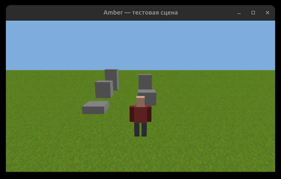

# Игровое время — задача #7

Работа ведётся поверх `neepi/input`. Игровая позиция и поворот персонажа
хранятся отдельно от графической сцены в `src/simulation.rs`.

Симуляция использует шаг 1/60 секунды. За графический кадр выполняется
не более восьми шагов; лишние целые шаги отбрасываются, дробный остаток
сохраняется. Кадры длиннее 250 мс полностью отбрасываются вместе с остатком:
после длительной остановки приложение не пытается догнать пропущенное время.
При сильных просадках симуляция замедляется, сохраняя ограниченный шаг движения.
Сцена синхронизируется один раз после обновлений. Дельта мыши применяется
один раз за графический кадр, без умножения на число физических шагов.

## Автоматические проверки

`cargo test --locked` проверяет перемещение за три секунды при 30, 60 и
144 графических кадрах в секунду, одинаковую скорость по диагонали,
ограничение работы после просадки и отсутствие долга после длинной паузы.
Это проверки симуляции без графического окна.

## Пауза при потере фокуса

`FixedClock::frame_steps` пропускает обновления при отсутствии фокуса окна.
Обработчик сцены в этом случае не применяет движение мыши и не меняет камеру.
Дробный остаток времени сбрасывается. Первый кадр после возвращения фокуса
также пропускается: его интервал мог включать время паузы.

Тест `focus_pause_freezes_player_and_discards_partial_step` проверяет
неподвижность персонажа и отсутствие накопленного времени после возврата.
Доступ к фокусу предоставляет временно подключённый полный SHA BFGE
`2b1457c3b4a0d0c168a82196bdaa79835073d62e` из
[PR #58](https://github.com/BFGEG/BFGE/pull/58). Перед слиянием Amber нужно
дождаться принятия этого PR и при необходимости обновить ревизию.

## Сравнение частоты кадров в окне

Обычный запуск сохраняет управление. Дополнительное ограничение FPS задаётся
переменной `AMBER_MAX_FPS` (целое число от 1 до 60). BFGE сам ориентируется
на максимум 60 кадров в секунду; 144 FPS проверяются только в тесте симуляции.
Ограничение не гарантирует достижение заданной частоты на любом оборудовании.

Для воспроизводимого сравнения запусти три раза:

```sh
AMBER_MAX_FPS=15 AMBER_TIMING_DEMO=1 cargo run --locked
AMBER_MAX_FPS=30 AMBER_TIMING_DEMO=1 cargo run --locked
AMBER_MAX_FPS=60 AMBER_TIMING_DEMO=1 cargo run --locked
```

Каждая команда открывает отдельное окно; закрой его перед следующим запуском.
Режим `AMBER_TIMING_DEMO=1` игнорирует WASD и мышь, перемещает персонажа
вдоль платформ 120 шагов (2 секунды симуляции), затем останавливает.
Окно должно иметь фокус. В консоли появляется пройденное расстояние,
сумма интервалов активных кадров и их фактическая частота.
Ожидаемое расстояние — 26,000 м при каждом ограничении. Между запусками
позиция восстанавливается созданием новой сцены. Во время прогона можно
переключиться на другое окно: движение должно продолжиться только после
возврата фокуса, без скачка.

При частоте ниже 7,5 FPS срабатывает ограничение восьми шагов за кадр,
а при интервалах более 250 мс кадр отбрасывается: в таких условиях симуляция
намеренно замедляется. На скорости обычного движения это не отражается
при 15, 30 и 60 FPS, если оборудование успевает отрисовать сцену.

## Проверки реализации

Прогоны в окне 1280×720 в текущем окружении дали при ограничении 15 FPS
26,000 м за 2,03 с активных кадров (15,3 FPS), при 30 FPS —
26,000 м за 2,01 с (30,4 FPS), при 60 FPS — 26,000 м за 2,01 с
(59,7 FPS). Значения времени и частоты приблизительны;
это проверка поведения, а не измерение производительности для главы.

Проверки форматирования, сборки, clippy и все шесть тестов прошли.
Дополнительно через X11 была проверена потеря фокуса и возврат: два снимка
игровой области во время паузы совпали пиксель в пиксель, после возобновления
прогон завершился на 26,000 м. Это автоматизированная проверка переключения
фокуса, а не ручное нажатие Alt-Tab. При записи частота снизилась примерно
до 52 FPS из-за захвата изображения; это не результат прогона без записи.
Ручную проверку Alt-Tab в обычной Wayland-сессии ещё нужно выполнить.

Короткая запись движения и переключения фокуса в X11:


